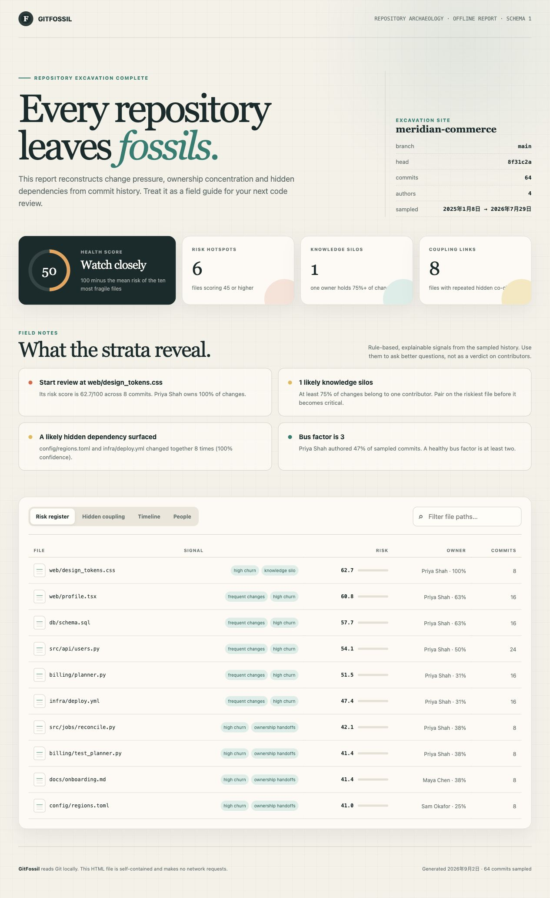
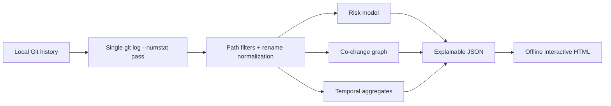

# GitFossil

[](https://github.com/Seeeeean0222/gitfossil/actions/workflows/ci.yml)
[](https://www.python.org/)
[](LICENSE)

**Turn a Git repository's history into an interactive engineering risk map.**

[Explore the live interactive demo](https://Seeeeean0222.github.io/gitfossil/) ·
[Read the methodology](docs/METHODOLOGY.md)

GitFossil is local-first repository archaeology. It reads commit strata to find
change hotspots, concentrated ownership, knowledge silos and files that repeatedly
change together even when they live far apart. The result is a portable HTML field
guide for code reviews, onboarding and maintenance planning.



```bash
python -m pip install git+https://github.com/Seeeeean0222/gitfossil.git
gitfossil scan /path/to/repository
```

No Node.js, account, API key, source upload or network connection is required.
Python 3.9+ and Git are the only runtime dependencies.

## Why another Git dashboard?

[`git-quick-stats`](https://github.com/git-quick-stats/git-quick-stats) showed how
much valuable context can be recovered through a focused command-line interface.
[`CodeCharta`](https://github.com/MaibornWolff/codecharta) showed how interactive
maps make architecture risks easier to discuss.

GitFossil borrows the strengths of both directions but starts from a different
question: **what does a repository's change history imply about future engineering
risk?** Instead of only counting commits, it connects temporal pressure,
ownership fragility and cross-directory co-change in one explainable model.

## What it surfaces

| Signal | Question it helps answer |
| --- | --- |
| File risk | Which files deserve attention first? |
| Knowledge concentration | Where does one person hold most change context? |
| Project bus factor | How many contributors cover 80% of history? |
| Hidden coupling | Which distant files repeatedly change as one unit? |
| Change timeline | When did additions, deletions and contributors peak? |
| Ownership handoffs | Where has context changed hands repeatedly? |

The report includes a filterable risk register, evidence for every score,
coupling confidence/lift, an excavation timeline and a contributor overview.
Open a file row to inspect its complete fossil record.

## Quick start

```bash
git clone https://github.com/Seeeeean0222/gitfossil.git
cd gitfossil
python3 -m venv .venv
source .venv/bin/activate
python -m pip install -e .

gitfossil scan . -o report.html --json report.json
```

Open `report.html` in any browser. It is a single self-contained file.

### Useful options

```bash
# Analyze the last 500 commits from the past year
gitfossil scan . --max-commits 500 --since "12 months ago"

# Respect all branches and keep merge commits
gitfossil scan . --all-refs --include-merges

# Ignore more generated or vendored paths
gitfossil scan . --exclude "fixtures/*" --exclude "*.generated.ts"

# Produce machine-readable data without the terminal summary
gitfossil scan . -o report.html --json report.json --quiet
```

Run `gitfossil scan --help` for all options.

## How it works



The runtime has no third-party packages. Git history is parsed in one process,
metrics are computed with standard Python data structures, and report data is
injected into a static template. See [METHODOLOGY.md](docs/METHODOLOGY.md) for
formulas, thresholds and limitations.

## Development

```bash
python -m unittest discover -s tests -t . -v
```

The suite creates real temporary Git repositories and covers commit parsing,
renames, exclusions, risk concentration, coupling suppression, timeline
aggregation and CLI artifacts. CI runs on Python 3.9, 3.12 and 3.13.

## Design notes for reviewers

- **Local-first privacy:** repository contents and paths never leave the machine.
- **Single-pass collection:** one Git subprocess avoids quadratic history scans.
- **Explainable scoring:** each file exposes the signals behind its score.
- **False-positive controls:** low-support pairs and bulk commits are filtered.
- **Stable identity:** email-based aggregation handles display-name changes.
- **Portable output:** the HTML embeds all CSS, JavaScript and report data.
- **Defensive rendering:** JSON is escaped before injection into the document.
- **No opaque AI dependency:** results are reproducible and testable.

## Limitations

Git history contains signals, not certainty. Commit identities are an imperfect
proxy for ownership, and co-change can reflect conventions rather than a true
dependency. These outputs should guide investigation, not performance evaluation.
Exclude generated, vendored and lock files when they dominate a repository.

## License

[MIT](LICENSE)
